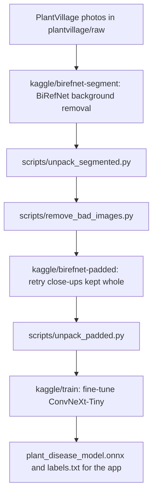

# CropCheckUp-training

Data preparation and training for the classifier behind
[CropCheckUp](https://github.com/rasagyavatsal/CropCheckUp), a browser app that
identifies crop-leaf conditions from a photo. Try it at
<https://cropcheckup-893696572314.us-central1.run.app>.

The pipeline removes the background from every PlantVillage photo with
BiRefNet, cleans up the masks and images it got wrong, then fine-tunes a
ConvNeXt-Tiny classifier for **38 crop and condition labels across 14 crops**
and exports it to ONNX for the app.

## Pipeline



| Step | What it does |
| --- | --- |
| `kaggle/birefnet-segment` | Runs BiRefNet-General on every image, one worker per GPU, and writes one zip of transparent PNGs per class. Masks covering under 10% of the photo fall back to the whole image. |
| `scripts/unpack_segmented.py` | Unpacks the class zips into `plantvillage/segmented/`, clears the colour hidden under fully transparent pixels, and rebuilds `manifest.json`, checking counts against `raw/`. |
| `scripts/remove_bad_images.py` | Moves 100 unusable photos (no leaf, label stakes, and an outdoor strawberry series whose background gave the class away) into `plantvillage/removed/`. Nothing is deleted. |
| `kaggle/birefnet-padded` | Pads the images kept whole with their own board colour at several ratios, runs BiRefNet on each, and keeps the mask that best matches a rough colour mask. |
| `scripts/unpack_padded.py` | Merges those masks into `segmented/`, skipping hazy ones, and records each merge in the manifest. |
| `kaggle/train` | Fine-tunes ConvNeXt-Tiny on the segmented images, evaluates it, and exports the ONNX model. |

## Training

| Setting | Configuration |
| --- | --- |
| Data | 54,205 PlantVillage images in 38 classes, composited onto black |
| Backbone | ConvNeXt-Tiny (`convnext_tiny.fb_in22k_ft_in1k`, timm), fine-tuned end to end |
| Input | 224 × 224 RGB |
| Split | 80% / 10% / 10% by a hash of each photo's ID, so duplicates of one leaf share a split |
| Augmentation | Rotation, flips, random-resized crops down to 25% of the image, colour jitter, blur |
| Imbalance | Classes sampled in proportion to √count, label smoothing 0.1 |
| Optimiser | AdamW, learning rate 0.0003, batch size 64, 12 epochs |

The exported model takes `image`, float32 `[N, 224, 224, 3]` RGB in `[0, 255]`,
normalises it itself, and returns softmax `probabilities` `[N, 38]` in
`labels.txt` order.

Results on the 5,371-image test split:

| Input | Accuracy | Balanced accuracy |
| --- | --- | --- |
| Segmented images, as in training | 99.61% | 99.20% |
| Centre crop hiding the background | 99.48% | 99.08% |

These are PlantVillage photos against plain backgrounds; accuracy on field
photos will be lower.

## Running it

The notebooks run on Kaggle with a T4 GPU and read the private Kaggle dataset
`rasagyavatsal/cropcheckup-dataset`, which holds `plantvillage/raw/` and,
for training, `plantvillage/segmented/`. Push a notebook with the Kaggle CLI:

```sh
kaggle kernels push -p kaggle/birefnet-segment
```

Download a run's output, then run the matching script locally against your copy
of the dataset (gitignored as `CropCheckUp-dataset/`):

```sh
python scripts/unpack_segmented.py OUTPUT_DIR CropCheckUp-dataset/plantvillage
python scripts/remove_bad_images.py CropCheckUp-dataset/plantvillage
python scripts/unpack_padded.py OUTPUT_DIR CropCheckUp-dataset/plantvillage
```

The scripts need Python 3 with NumPy and Pillow. Upload the updated
`segmented/` folder to the Kaggle dataset before running `kaggle/train`.

The training run writes `plant_disease_model.onnx`, `labels.txt`,
`metrics.json`, `history.json`, `split.json` and `best.pt`. To use a new model,
copy `plant_disease_model.onnx` into the app's `public/models/`, and upload it to
the app's Cloud Storage bucket as described in the app's README.
